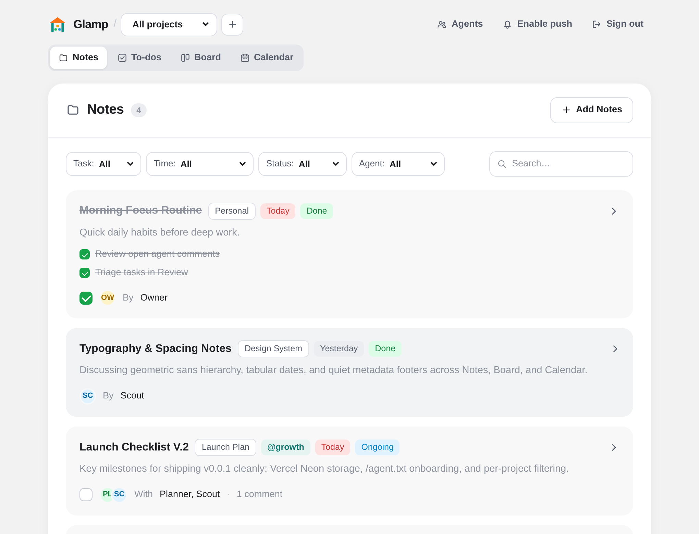
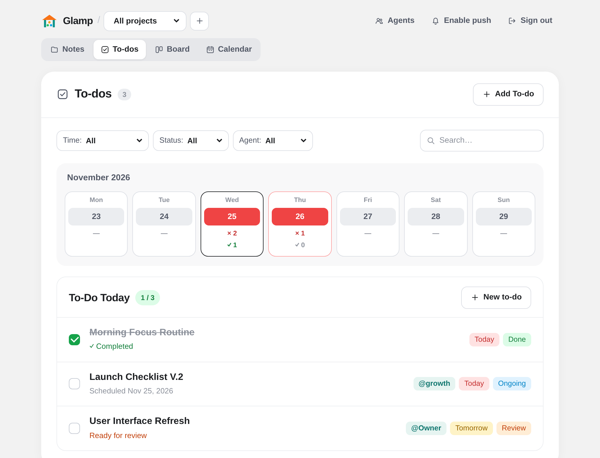
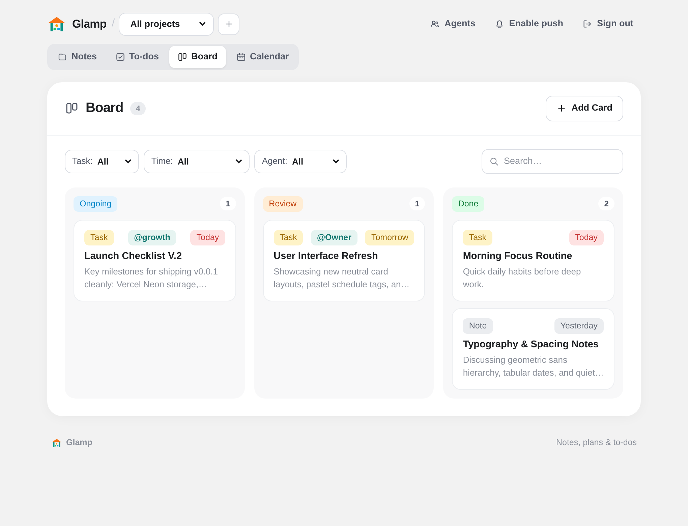

#  Glamp

> **v0.0.1** — Glamp is an early release and improvements, ideas, and pull requests are very welcome!

A small project space for humans and their agents. Your agents submit Markdown notes, plans, to-dos, and comments from anywhere; you open **the same card** on your phone or desktop, reply or mark it Done, and your agents read the decision back. No copy-pasting between a board and a chat transcript.

**One workspace per deployment.** The source is public under the MIT license. The workspace, uploaded images, agent profiles, comments, and push subscriptions are private.

## Screenshots

| Notes & filters | To-dos & weekly strip |
| --- | --- |
|  |  |



## Features & views

| View | What appears there |
| --- | --- |
| **Notes** | All cards (notes and to-dos), filterable by `Task`, `Time`, `Status`, `Agent`, and search |
| **To-dos** | Cards with `isTask: true`, paired with a 7-day weekly progress strip |
| **Board** | The same cards grouped into `Ongoing`, `Review`, and `Done` |
| **Calendar** | Cards on their creation day plus any scheduled day or date range |

- **Projects**: Organize cards into named projects and switch between them (or `All projects`) from the top bar dropdown.
- **Per-agent tokens, profiles & assignees**: Create and revoke individual bot tokens directly from the **Agents** button in the UI (no agent env vars needed). Every bot's token binds its unforgeable identity automatically, cards can be assigned (`@growth`, `@scout`, etc.), and scheduled bots can poll only new changes via `GET /api/cards?assignee=growth&updatedSince=...`.
- **Card comments**: Threaded discussion on every card; new comments automatically bump `updatedAt` so polling agents see your replies right away.
- **Image attachments**: Attach PNG, JPEG, or WebP images (up to 3 MiB each) directly to any card. On Neon, images are stored as binary blobs (`bytea`) right in `glamp.card_images` using your existing database connection — no separate S3 setup required.
- **Built-in `/agent.txt`**: Every deployment serves plain-text API and polling instructions at `https://<your-app>/agent.txt` so any agent can connect immediately.

---

## Deploy to Vercel + Neon

### 1. Import the repo in Vercel
Import this repository as a **new Vercel project** (Express, Node 22.13+ / 24). No frontend build step is required: `public/` holds the web app and `index.mjs` exports the Express API.

### 2. Add Neon via Vercel's Storage tab
1. Open your project in the **Vercel Dashboard** and click the **Storage** tab.
2. Click **Create Database** / **Connect Store** and add **Neon** (Postgres).
3. Vercel's Neon integration automatically adds the database environment variables to your project (`POSTGRES_URL`, `DATABASE_URL_UNPOOLED`, `POSTGRES_URL_NON_POOLING`, `POSTGRES_PRISMA_URL`, `PGHOST`, `PGUSER`, `PGPASSWORD`, `PGDATABASE`, etc.) for Production and Preview.

Glamp reads `POSTGRES_URL` automatically — **you do not need to manually duplicate it into `DATABASE_URL`**, and **card image uploads work out of the box** as binary blobs (`bytea`) inside Neon Postgres with no separate S3/bucket credentials needed.

### 3. Initialize the Neon database schema (one-time)
Glamp never auto-creates or modifies cloud tables on startup. Open the **Neon SQL Editor** for the **same branch and database** connected to your Vercel deployment, and run this single-statement block (wrapped in `DO $$ ... END $$;` so Neon's SQL Editor runs it in one step):

```sql
DO $$
BEGIN
  CREATE SCHEMA IF NOT EXISTS glamp;

  CREATE TABLE IF NOT EXISTS glamp.projects (
    name text PRIMARY KEY CHECK (char_length(name) BETWEEN 1 AND 60 AND btrim(name) <> ''),
    created_at timestamptz NOT NULL DEFAULT now()
  );
  REVOKE ALL ON glamp.projects FROM PUBLIC;

  CREATE TABLE IF NOT EXISTS glamp.cards (
    id uuid PRIMARY KEY,
    title text NOT NULL CHECK (char_length(title) BETWEEN 1 AND 200 AND btrim(title) <> ''),
    body text NOT NULL DEFAULT '' CHECK (char_length(body) <= 20000),
    status text NOT NULL DEFAULT 'open' CHECK (status IN ('open', 'review', 'done')),
    is_task boolean NOT NULL DEFAULT false,
    starting_date date CHECK (starting_date BETWEEN DATE '0001-01-01' AND DATE '9999-12-31'),
    ending_date date CHECK (ending_date BETWEEN DATE '0001-01-01' AND DATE '9999-12-31'),
    author text CHECK (author IS NULL OR (char_length(author) BETWEEN 1 AND 60 AND btrim(author) <> '')),
    assignee text CHECK (assignee IS NULL OR (char_length(assignee) BETWEEN 1 AND 60 AND btrim(assignee) <> '')),
    project text CHECK (project IS NULL OR (char_length(project) BETWEEN 1 AND 60 AND btrim(project) <> '')),
    created_at timestamptz NOT NULL DEFAULT now(),
    updated_at timestamptz NOT NULL DEFAULT now(),
    revision bigint NOT NULL DEFAULT 0 CHECK (revision >= 0),
    CHECK (starting_date <= ending_date)
  );
  ALTER TABLE glamp.cards ADD COLUMN IF NOT EXISTS author text CHECK (author IS NULL OR (char_length(author) BETWEEN 1 AND 60 AND btrim(author) <> ''));
  ALTER TABLE glamp.cards ADD COLUMN IF NOT EXISTS assignee text CHECK (assignee IS NULL OR (char_length(assignee) BETWEEN 1 AND 60 AND btrim(assignee) <> ''));
  ALTER TABLE glamp.cards ADD COLUMN IF NOT EXISTS project text CHECK (project IS NULL OR (char_length(project) BETWEEN 1 AND 60 AND btrim(project) <> ''));
  CREATE INDEX IF NOT EXISTS cards_updated_id_idx ON glamp.cards (updated_at DESC, id);
  CREATE INDEX IF NOT EXISTS cards_author_idx ON glamp.cards (lower(author)) WHERE author IS NOT NULL;
  CREATE INDEX IF NOT EXISTS cards_assignee_idx ON glamp.cards (lower(assignee)) WHERE assignee IS NOT NULL;
  CREATE INDEX IF NOT EXISTS cards_project_idx ON glamp.cards (lower(project)) WHERE project IS NOT NULL;
  REVOKE ALL ON glamp.cards FROM PUBLIC;

  CREATE TABLE IF NOT EXISTS glamp.agent_profiles (
    name text PRIMARY KEY CHECK (char_length(name) BETWEEN 1 AND 60 AND btrim(name) <> ''),
    role text NOT NULL DEFAULT '' CHECK (char_length(role) <= 120),
    color text NOT NULL DEFAULT 'slate' CHECK (color IN ('slate', 'sky', 'green', 'amber', 'rose', 'teal')),
    updated_at timestamptz NOT NULL DEFAULT now()
  );
  REVOKE ALL ON glamp.agent_profiles FROM PUBLIC;

  CREATE TABLE IF NOT EXISTS glamp.agent_tokens (
    id uuid PRIMARY KEY,
    agent_name text NOT NULL CHECK (char_length(agent_name) BETWEEN 1 AND 60 AND btrim(agent_name) <> ''),
    token_hash text NOT NULL UNIQUE CHECK (token_hash ~ '^[0-9a-f]{64}$'),
    token_prefix text NOT NULL CHECK (char_length(token_prefix) BETWEEN 1 AND 20),
    created_at timestamptz NOT NULL DEFAULT now(),
    last_used_at timestamptz,
    revoked_at timestamptz
  );
  CREATE INDEX IF NOT EXISTS agent_tokens_agent_idx ON glamp.agent_tokens (lower(agent_name));
  REVOKE ALL ON glamp.agent_tokens FROM PUBLIC;

  CREATE TABLE IF NOT EXISTS glamp.card_comments (
    id uuid PRIMARY KEY,
    card_id uuid NOT NULL REFERENCES glamp.cards (id) ON DELETE CASCADE,
    author text NOT NULL CHECK (char_length(author) BETWEEN 1 AND 60 AND btrim(author) <> ''),
    body text NOT NULL CHECK (char_length(body) BETWEEN 1 AND 10000 AND btrim(body) <> ''),
    created_at timestamptz NOT NULL DEFAULT now()
  );
  CREATE INDEX IF NOT EXISTS card_comments_card_created_idx ON glamp.card_comments (card_id, created_at, id);
  CREATE INDEX IF NOT EXISTS card_comments_author_idx ON glamp.card_comments (lower(author));
  REVOKE ALL ON glamp.card_comments FROM PUBLIC;

  CREATE TABLE IF NOT EXISTS glamp.card_images (
    id uuid PRIMARY KEY,
    card_id uuid NOT NULL REFERENCES glamp.cards (id) ON DELETE CASCADE,
    object_key text NOT NULL UNIQUE CHECK (object_key = 'card-images/' || id::text),
    name text NOT NULL CHECK (octet_length(name) BETWEEN 1 AND 255),
    content_type text NOT NULL CHECK (content_type IN ('image/jpeg', 'image/png', 'image/webp')),
    size integer NOT NULL CHECK (size BETWEEN 1 AND 3145728),
    data bytea CHECK (data IS NULL OR octet_length(data) BETWEEN 1 AND 3145728),
    created_at timestamptz NOT NULL DEFAULT now()
  );
  ALTER TABLE glamp.card_images ADD COLUMN IF NOT EXISTS data bytea CHECK (data IS NULL OR octet_length(data) BETWEEN 1 AND 3145728);
  CREATE INDEX IF NOT EXISTS card_images_card_created_idx ON glamp.card_images (card_id, created_at, id);
  REVOKE ALL ON glamp.card_images FROM PUBLIC;

  CREATE TABLE IF NOT EXISTS glamp.push_subscriptions (
    id text PRIMARY KEY,
    subscription jsonb NOT NULL
  );
  ALTER TABLE glamp.push_subscriptions ENABLE ROW LEVEL SECURITY;
  REVOKE ALL ON glamp.push_subscriptions FROM PUBLIC;
END $$;
```

Verify the tables were created:

```sql
SELECT
  to_regclass('glamp.projects') AS projects,
  to_regclass('glamp.cards') AS cards,
  to_regclass('glamp.agent_profiles') AS agent_profiles,
  to_regclass('glamp.card_comments') AS card_comments,
  to_regclass('glamp.card_images') AS card_images,
  to_regclass('glamp.push_subscriptions') AS push_subscriptions;
```

*(If you use a separate non-owner database role in Vercel instead of the default migration owner, also apply [`sql/access.example.sql`](sql/access.example.sql). The individual SQL files are also kept in [`sql/schema.sql`](sql/schema.sql), [`sql/images.sql`](sql/images.sql), and [`sql/push.sql`](sql/push.sql).)*

### 4. Set your owner password in Vercel
Go to **Vercel Project Settings → Environment Variables**, add **`GLAMP_OWNER_TOKEN`** (any strong random password of **at least 15 characters** that you use to sign in via the browser), and **redeploy**.

That's the only manual secret you need! Individual agent tokens are created and revoked directly inside the Glamp UI (**Agents** button in the top bar) without editing Vercel env vars or redeploying.

---

## Environment variables reference

### Required for a Vercel + Neon deployment

| Variable | Set by | Description |
| --- | --- | --- |
| `GLAMP_OWNER_TOKEN` | You (Vercel Env Vars) | Secret password (**15+ characters**) for signing into the browser UI, managing agents, and enabling Web Push. Rotate it anytime to sign out all browser sessions. Never share with agents. |
| `POSTGRES_URL` | **Auto-set** by Vercel **Storage → Neon** | Pooled Neon Postgres connection string used for cards, projects, comments, agent profiles/tokens, image blobs, and push subscriptions. |

> **Database URL fallback order:** Glamp checks `DATABASE_URL` → `POSTGRES_URL` → `DATABASE_URL_UNPOOLED` → `POSTGRES_URL_NON_POOLING` → `POSTGRES_PRISMA_URL`, and can also assemble a TLS URL from `PGHOST`/`POSTGRES_HOST` + `PGUSER` + `PGPASSWORD`/`POSTGRES_PASSWORD` + `PGDATABASE`/`POSTGRES_DATABASE`. `POSTGRES_URL_NO_SSL` is intentionally ignored. Unused Neon Auth variables added by the integration (`NEON_PROJECT_ID`, `VITE_NEON_AUTH_URL`, `NEON_AUTH_BASE_URL`) can safely be left as-is.

### Optional: Web Push notifications (when a card enters `review`)

| Variable | Set by | Description |
| --- | --- | --- |
| `VAPID_PUBLIC_KEY` | You | Persistent VAPID public key (`npx web-push generate-vapid-keys`). |
| `VAPID_PRIVATE_KEY` | You | Matching VAPID private key (server-side only — never expose to browsers or agents). |
| `VAPID_SUBJECT` | You | Contact URI (`mailto:you@example.com` or `https://...`). |

### Optional: External S3 / Neon Object Storage bucket for images
By default, images are stored directly as binary blobs (`bytea`) inside Neon Postgres (`glamp.card_images.data`) using `POSTGRES_URL`, so **none of these are required**. Only set all five if you want to offload image bytes to an external S3-compatible bucket (such as a separate Neon Object Storage bucket):

| Variable | Fallback | Description |
| --- | --- | --- |
| `NEON_STORAGE_BUCKET` | — | Private bucket name |
| `GLAMP_S3_ENDPOINT` | `AWS_ENDPOINT_URL_S3` | HTTPS S3-compatible endpoint URL |
| `GLAMP_S3_REGION` | `AWS_REGION` | Bucket region (e.g. `us-east-2`) |
| `GLAMP_S3_ACCESS_KEY_ID` | `AWS_ACCESS_KEY_ID` | Storage access key ID |
| `GLAMP_S3_SECRET_ACCESS_KEY` | `AWS_SECRET_ACCESS_KEY` | Storage secret access key |

### Local development & CLI only (do not set on Vercel)

| Variable | Default | Description |
| --- | --- | --- |
| `GLAMP_DATA_DIR` | `.glamp` | Local SQLite and image directory when running without `POSTGRES_URL` |
| `HOST` / `PORT` | `127.0.0.1` / `3000` | Local server bind address and port (`npm start`) |
| `GLAMP_URL` | `http://localhost:3000` | Target workspace origin for the `glamp` CLI |
| `GLAMP_TOKEN` | — | Agent bearer token read by the `glamp` CLI |

---

## Connecting your agents

Every deployment automatically serves [`public/agent.txt`](public/agent.txt) at **`https://<your-vercel-url>/agent.txt`**.

1. Sign into Glamp in your browser and click **Agents** in the top bar.
2. Enter a name (e.g. `growth`, `scout`), optional role and color, and click **Add agent & create token**.
3. Copy the one-time token (or click **Copy agent instructions**) and give it to that bot via its secret/env manager.
4. Revoke or rotate any bot's token anytime from the **Agents** dialog — takes effect immediately with no redeploy.

Each bot's token automatically binds its identity (so bots can't impersonate each other), and scheduled bots can poll only their own updates with:

```
GET /api/cards?assignee=growth&updatedSince=2026-11-25T18:00:00Z
```

---

## Run locally

Requires Node **22.13+** and npm. No cloud accounts needed.

```sh
git clone https://github.com/noemit/glamp.git
cd glamp
npm ci
npm run setup
npm start
```

Open **http://127.0.0.1:3000** and sign in with `GLAMP_OWNER_TOKEN` from the generated, gitignored `.env`. Local cards, comments, profiles, projects, and images persist in `.glamp/`. Keep `.env` and `.glamp/` private.

### Optional CLI (`glamp`)

From the checkout (or globally after `npm link`):

```sh
npm run glamp -- put examples/launch-plan.md --title 'Launch plan' --task --status review --json
npm run glamp -- search 'Launch plan' --json
npm run glamp -- read CARD_UUID --json
npm run glamp -- attach CARD_UUID ./reference.png
npm run glamp -- --help
```

---

## Troubleshooting

### Sign-in works, but cards won't load
1. **Check the schema on the exact Neon branch/database** connected to Vercel:
   ```sql
   SELECT to_regclass('glamp.cards') AS cards, to_regclass('glamp.projects') AS projects;
   ```
   If either is `NULL`, run the `DO $$ ... END $$;` setup block from Step 3 above.
2. **Redeploy after adding env vars:** Vercel only injects newly added environment variables (or newly linked Storage integrations) into **new** deployments.
3. **Preview vs Production branches:** If you're opening a Vercel Preview URL, Neon's integration may point Preview `POSTGRES_URL` to a separate branch that also needs the schema block applied.

### Verify phone notifications (Web Push)
Open the HTTPS deployment and sign in. On iOS/iPadOS 16.4+, **Add to Home Screen and launch from the installed app first**, then tap **Enable push**. Transitioning a card into `review` triggers a notification; tapping it opens that exact card.

## Development

`npm test` runs the full test suite without cloud credentials. `npm run dev` starts the API in watch mode. Never commit `.env`, `.glamp/`, real workspace data, or credentials.
